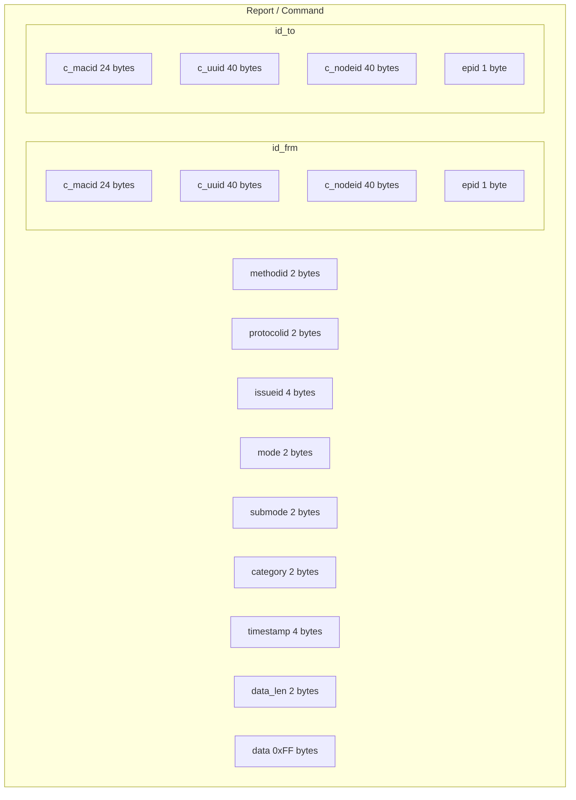

# 1. Software Layer
## 1.1. Table
| beex_123 / zwecho / queen_bee |
| ------------- |
| libbeex |
| libutilx (multicast_api) |

# 2. App and Sequence
#### A. queen_bee

   ```sequence
   Broker -> queen_bee: MQTT
   queen_bee -> dongle: MCTT
   dongle --> queen_bee: MCTT
   queen_bee --> Broker:MQTT
   ```

#### B. zwecho

   ```sequence
   zwecho -> dongle: MCTT
   dongle --> zwecho: MCTT
   ```

#### C. master

   ```sequence
   WEB CGI-> master: D-Bus
   master -> dongle: MCTT
   dongle --> master: MCTT
   master --> WEB CGI:D-Bus
   ```

# 3. Reserved ID

   ```
#define JVAL_C_MAC_NULL                          "000000000000"
#define JVAL_C_MAC_BROADCAST                     "FFFFFFFFFFFF"
#define JVAL_C_UUID_NULL                         "00000000-0000-0000-0000"
#define JVAL_C_UUID_BROADCAST                    "FFFFFFFF-FFFF-FFFF-FFFF"

#define JVAL_C_NODEID_NULL                       "00000000-0000-0000-0000"
#define JVAL_C_NODEID_0                          "0"
#define JVAL_C_NODEID_1                          "1"
#define JVAL_C_NODEID_BROADCAST                  "FFFFFFFF-FFFF-FFFF-FFFF"
   ```

# 4. Data Struct

## 4.1. Report/Command Struct

   ```
methodid 2/protocolid 2
id_frm: c_macid 24/c_uuid 40/c_nodeid 40/epid 1
id_to: c_macid 24/c_uuid 40/c_nodeid 40/epid 1
issue: issueid 4 /mode 2/submode 2/category 2/timestamp 4/data_len 2/data 0xFF
   ```

## 4.2. IssueItem_t



```c
typedef struct IssueItem_Struct
{
	union
	{
		Reporter_t reporter;
		Commander_t commander;
	};

	uint32_t issueid;
	uint16_t mode;
	uint16_t submode;
	uint16_t category;
	uint32_t timestamp;
	// 71+4+2+2+2+4 = 85

	uint16_t data_len; // to support 0xFF 0xFF
	char data[0xFF]; // 256
} IssueItem_t;
```

### 4.2.1. Commander_t

   ```
typedef struct Commander_Struct
{
	uint16_t methodid;
	uint16_t protocolid;
	Identity_t id_frm;
	Identity_t id_to;
} Commander_t;
   ```

### 4.2.2. Reporter_t
   ```
typedef struct Reporter_Struct
{
	uint16_t methodid;
	uint16_t protocolid;
	Identity_t id_frm;
} Reporter_t;
   ```

### 4.2.3. Identity_t

   ```
typedef struct Identity_Struct
{
	char c_macid[LEN_OF_MAC]; // LEN_OF_MAC 24
	char c_uuid[LEN_OF_UUID]; // LEN_OF_UUID 40
	char c_nodeid[LEN_OF_UUID]; // LEN_OF_UUID 40
	uint8_t epid; // 0xFF
} Identity_t;
   ```

